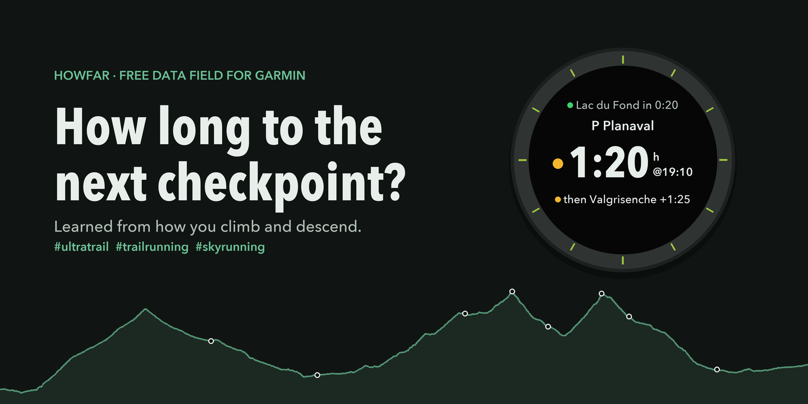

# HowFar?

**How long to the next checkpoint?** A free data field for Garmin watches that tells trail and ultra runners the time to the next checkpoint of their course, learned from how they climb and descend.

**[Website and demo](https://howfar-garmin.github.io/howfar/)** · **[Race prep](https://howfar-garmin.github.io/howfar/prepare.html)** · **License:** MIT

## What it shows

While you follow a course, three lines:

- **the next checkpoint**, with **P** when it knows every climb and descent to it, or **~** when it only knows the height difference
- **the time to get there** while you keep moving (time stopped at aid stations isn't counted)
- **the time of day you'll arrive**

On a full-screen field, with a course profile, a fourth line shows the checkpoint after that and when you'll get there.

It learns your pace on every slope and keeps learning during the race, correcting for how your day is going.

## Install

Free in the **Garmin Connect IQ Store**: search for *HowFar?* in the Connect IQ Store in the Garmin Connect app (or the Connect IQ app), install, and sync your watch. Then add it to a data screen of your Trail Run activity.

Works on the **Enduro 3**, **fēnix 8** and **epix Pro (Gen 2)**. Without the store, the [latest release](https://github.com/howfar-garmin/howfar/releases/latest) has a file per watch to copy over USB (that way it has no settings).

## Prepare a race (optional)

The [race prep page](https://howfar-garmin.github.io/howfar/prepare.html) turns your past activities and the race's course file into two texts you paste into HowFar?'s settings in Garmin Connect. It runs in your browser; your files never leave your device.

## Privacy

HowFar? collects nothing. What it learns stays on your watch, and the race prep page works without uploading anything.

## Developers

Building, testing, the algorithm and how it was chosen: see [DEVELOPMENT.md](DEVELOPMENT.md).

Not affiliated with Garmin.
